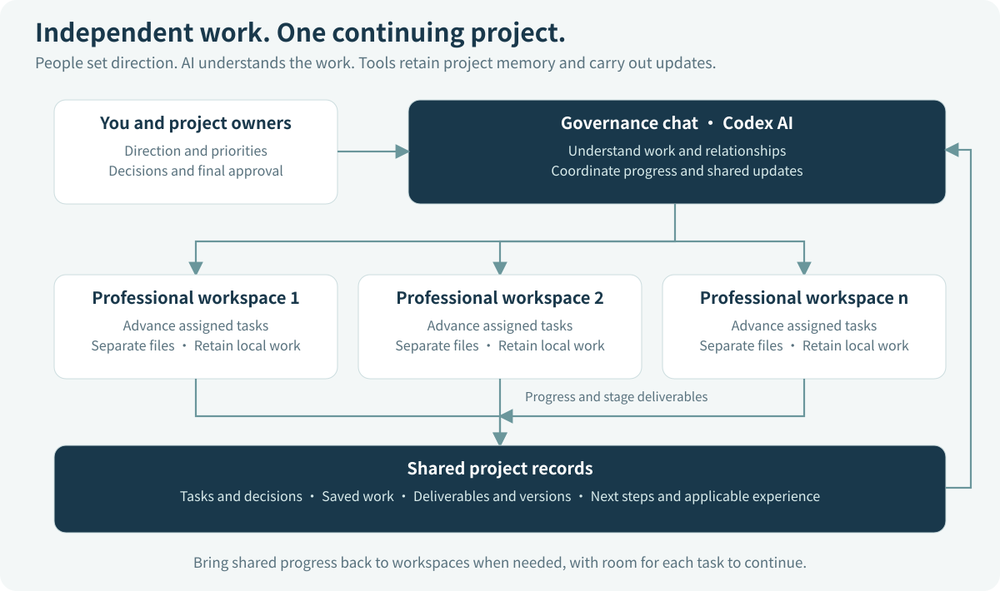
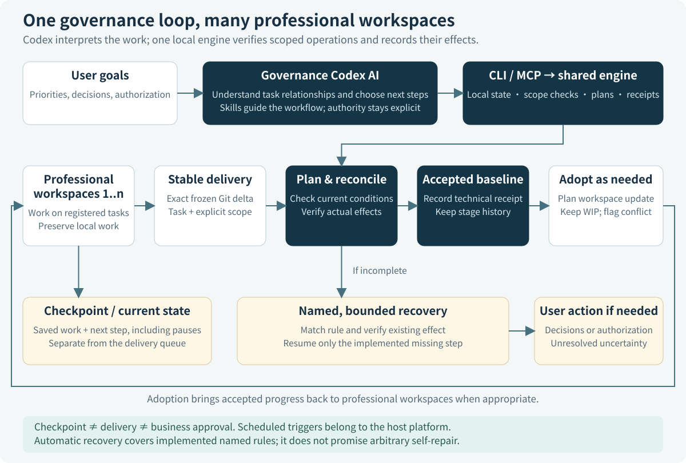

# TaskCarry

**Project memory and collaboration for AI tools.**

[English](README.md) · [简体中文](README.zh-CN.md) · [繁體中文](README.zh-TW.md)

[Download TaskCarry](https://github.com/bryan123466/taskcarry/releases/tag/v0.2.0rc4) · [Start with the user manual](docs/en/windows-example.md) · [See the architecture](docs/en/architecture.md)

Keep a long-running project moving across AI conversations, workspaces, and pauses. TaskCarry saves the task context, selected work, deliverable history, and next steps that help you pick up where you left off.

Use it when one project has outgrown a single conversation: software and documentation advancing together, a research project with several workstreams, or a product with development, operations, and writing happening in parallel. Your AI tool helps do the work; TaskCarry gives that work a durable local record and a way to bring results together.

**The current step-by-step examples use Codex.** The toolkit exposes the same local engine through a command line and MCP, providing a foundation for other AI-tool integrations. Each host still needs its own connection and workflow verification.

## Why add TaskCarry to Git and project instructions?

Git already keeps file history. Project instructions such as AGENTS.md already explain how an AI assistant should work. A handoff message already helps the next conversation get started. TaskCarry connects these useful pieces to the changing state of a project.

| What you already use | What it helps with | What TaskCarry adds |
|---|---|---|
| Git | Versions, branches, and file changes | Which task a result belongs to, which stage was received, and what still needs to continue. |
| AGENTS.md and Skills | Working practices and role instructions | Persistent records of the work actually saved, offered, integrated, or paused. |
| Conversation summaries | Context for a person or another chat | Task records and file references you can update and revisit beyond one conversation. |
| Manual handoffs | Coordination between a few workstreams | Reviewed plans, recorded operation results, and supported recovery when work is interrupted. |

For a short task in one chat, your existing tools may be enough. TaskCarry becomes useful when you repeatedly need to answer: **Where did we stop? Which result is current? What has already joined the project?**

## What stays with your project?

| Capability | What you can do |
|---|---|
| **Project memory** | Retain task goals, recorded decisions, current position, and next steps outside chat context. |
| **Saved pause points** | Keep selected saved files and continuation notes without pretending the task is finished. |
| **Multiple workspaces** | Let parallel tasks use separate working directories, then collect their ready results into a shared project version. |
| **Stage-by-stage delivery** | Contribute a useful stage while the rest of a task continues. Track explicit relationships between later and earlier stages. |
| **Clear current work** | Read a focused, paginated agenda while keeping paused work and completed history available. |
| **Interrupted-work recovery** | Check recorded and actual effects, reuse supported recovery methods, and continue missing steps without blindly repeating completed work. |
| **Material references** | Record where larger files live and whether a specified backup matches, without putting every file into Git. |

Memory comes from the tasks, notes, files, and deliveries you or your AI assistant explicitly connect. TaskCarry does not automatically collect all private conversations or capture unsaved editor content.

## How people, AI, and tools work together

Your **governance chat** coordinates the project. It uses the AI capabilities of your host to understand the supplied work information, review the current state, and call TaskCarry tools. Specialist chats focus on their own tasks in clearly assigned workspaces.

TaskCarry stores records and performs the supported local operations. You retain decisions about project direction, priorities, business acceptance, and external delivery. The toolkit does not require a separate model API or train a model.

For example, software may have a usable module while experiments are paused and documentation is still a draft. Governance can receive the software stage and retain the other two tasks at their current positions. Nobody needs to mark the entire project complete just to preserve useful progress.

## The everyday workflow

1. **Work in your task chat.** Continue the real task in its assigned workspace.
2. **Save a useful stopping point.** Record the current position and selected files when you pause.
3. **Offer a ready result.** Identify the stable version and the files it changes.
4. **Bring it into the project.** The governance chat reviews a plan and receives the stage through the tools.
5. **Continue from shared progress.** Update the workspaces that need those business changes, preserving supported local work and addressing concrete conflicts.

A received stage can be part of an unfinished task. A paused task can stay paused. Replacing an older stage requires a documented relationship and matching change history, so independent results are not discarded merely because a newer file exists.

## Start with one project

Download **taskcarry-0.2.0rc4-product.zip** from the [release page](https://github.com/bryan123466/taskcarry/releases/tag/v0.2.0rc4), then follow the [Windows user manual](docs/en/windows-example.md).

1. **Create the project directory and governance chat.** The manual gives a concrete folder example and a copyable installation prompt. Fill in **[Project name]** and **[One-sentence introduction]**.
2. **Connect existing work or add task workspaces.** Keep a suitable existing chat, or create independent workspaces for parallel tasks. Fill in **[The actual work this chat is responsible for]**.
3. **Ask governance to run its first review.** It checks the connected project and reports the result in that same chat. You can then continue working and add scheduling when useful.

There is no separate report application to open. Initial setup feedback and everyday project summaries are produced by your governance AI in its chat, using TaskCarry records and tools. A configured host automation can perform those reviews on a schedule.

You do not need to learn the engine, inspect its database, or run developer tests before using the product.

This is an organization example. Choose your own roles and number of chats. If several existing chats share a working directory, retain one main writer there and move responsibilities that need parallel work into separate workspaces, as the manual explains.

## Build on the local workflow

- **Scheduled coordination:** use your host's scheduling feature to ask governance to review connected work and produce a useful summary. Installing TaskCarry does not create a schedule.
- **Private Git:** configure your own remote repository for selected committed results. File references help locate materials, but copying, backup, and remote synchronization remain explicit operations.
- **Additional AI tools:** CLI and MCP provide integration points around one engine. The Codex guide is the current concrete onboarding path; it does not establish that every MCP client, model, or AI platform has been verified.
- **Multiple computers:** the [guide](docs/en/remote-and-multicomputer.md) describes separate task branches and one integration computer. Real two-computer operation has not completed end-to-end validation; start after the local workflow is established.

TaskCarry uses Python 3.11+; Git is needed for Git workflows. It stores project state locally and includes four project Skills for setup, task delivery, governance, and recovery. Each control scope has one local store and one receiving baseline. Installation updates tools and Skills; adopting received business changes into a workspace is a separate, reviewed action. See [maintenance](docs/en/governance-maintenance.md) and [capabilities and limits](docs/RELEASE_BOUNDARIES.md).

## Documentation

| Guide | English | 简体中文 | 繁體中文 |
|---|---|---|---|
| User manual | [Start here](docs/en/windows-example.md) | [从这里开始](docs/zh-CN/windows-example.md) | [從這裡開始](docs/zh-TW/windows-example.md) |
| Architecture | [How it works](docs/en/architecture.md) | [架构说明](docs/zh-CN/architecture.md) | [架構說明](docs/zh-TW/architecture.md) |
| Maintenance | [Maintain a project](docs/en/governance-maintenance.md) | [维护项目](docs/zh-CN/governance-maintenance.md) | [維護專案](docs/zh-TW/governance-maintenance.md) |
| Private Git and multiple computers | [Guide](docs/en/remote-and-multicomputer.md) | [说明](docs/zh-CN/remote-and-multicomputer.md) | [說明](docs/zh-TW/remote-and-multicomputer.md) |

[CLI / MCP reference](docs/COMMANDS.md) · [Public Skills](skills) · [Validation records](https://github.com/bryan123466/taskcarry/blob/v0.2.0rc4/docs/VALIDATION.md)

## Join in

Questions, real use cases, clearer examples, translations, and code improvements are welcome. Start with [Issues](https://github.com/bryan123466/taskcarry/issues) or the [contribution guide](https://github.com/bryan123466/taskcarry/blob/v0.2.0rc4/CONTRIBUTING.md). Remove private project information before sharing; the [security guide](SECURITY.md) explains what to keep out of a report.

## License

The public code, documentation, templates, and examples use the [MIT license](LICENSE), including commercial reuse under its terms. Your own project and materials remain yours to manage; using TaskCarry does not make them public. Dependencies and services retain their own terms. See [license scope](LICENSE_SCOPE.md).
