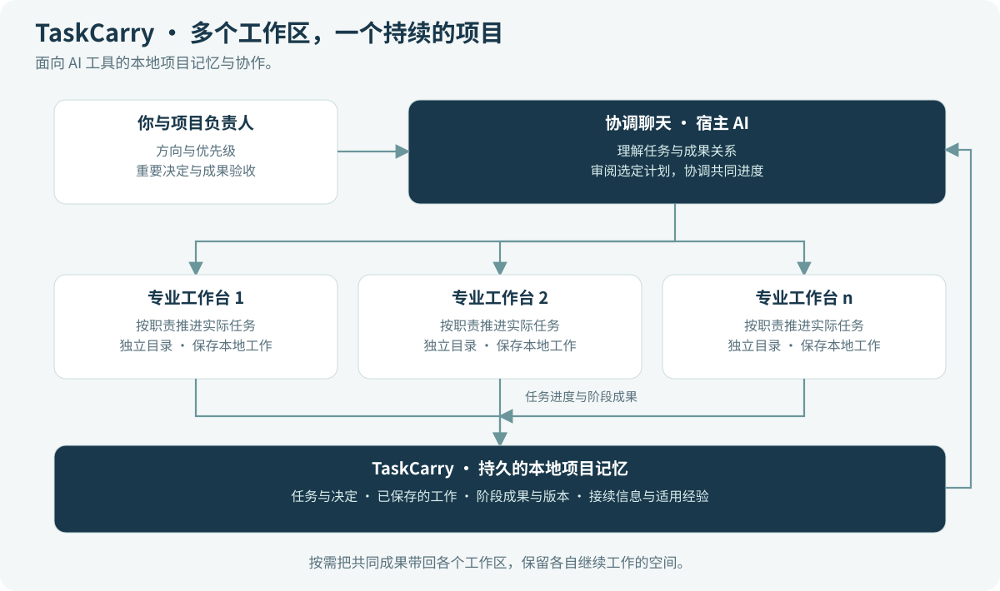
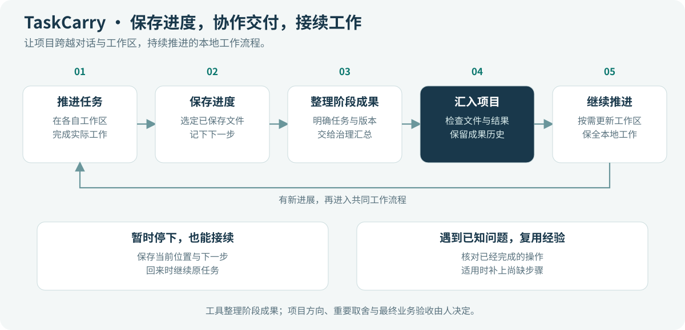

# TaskCarry

**为 AI 工具提供项目记忆与协作能力。**

[English](README.md) · [简体中文](README.zh-CN.md) · [繁體中文](README.zh-TW.md)

[下载 TaskCarry](https://github.com/bryan123466/taskcarry/releases/tag/v0.2.0rc4) · [从操作手册开始](docs/zh-CN/windows-example.md) · [了解架构](docs/zh-CN/architecture.md)

让一个长期项目能够跨越 AI 对话、工作区和暂停时段继续推进。TaskCarry 保存任务背景、选定的工作文件、成果历史与下一步，帮助你回到上次停下的位置。

当一个项目开始超出单个对话的范围，它就能派上用场：软件和文档同时推进，科研项目拆成几条工作线，或产品开发、运营与文书工作并行开展。你使用的 AI 工具帮助完成工作，TaskCarry 为这些工作提供持久的本地记录，以及汇总成果的方法。

**当前的完整操作示例使用 Codex。** 工具通过命令行和 MCP 提供同一套本地能力，为接入其他 AI 工具留下扩展基础。每种宿主仍需要单独确认连接和工作流程。

## 已经有 Git 和项目指令，为什么还需要 TaskCarry？

Git 保存文件历史，AGENTS.md 等项目指令说明 AI 应该如何工作，交接摘要帮助下一个对话进入状态。TaskCarry 把这些已有工具与项目不断变化的实际进度联系起来。

| 你已经在使用的工具 | 它解决什么 | TaskCarry 补充什么 |
|---|---|---|
| Git | 文件版本、分支与修改历史 | 成果属于哪个任务、哪个阶段已被接收、还有什么需要继续。 |
| AGENTS.md 与 Skills | 工作方法与角色说明 | 实际保存、交付、汇入项目或暂停的工作记录。 |
| 对话摘要 | 给人或下一个聊天补充背景 | 可以持续更新、跨会话查阅的任务记录与文件位置。 |
| 手工交接 | 协调少量工作线 | 可检查的接收计划、实际操作记录，以及中断后已支持的接续方法。 |

一个聊天中的短任务，现有工具可能已经足够。当你需要反复回答 **“上次停在哪里？哪份成果是当前版本？什么已经汇入项目？”** 时，TaskCarry 会更有帮助。

## 哪些内容能跟着项目保留下来？

| 能力 | 可以怎样使用 |
|---|---|
| **项目记忆** | 在聊天之外保存任务目标、已记录的决定、当前位置与下一步。 |
| **保存暂停位置** | 保留选定的已保存文件和接续说明，不必把尚未完成的任务标成结束。 |
| **多个工作区协作** | 并行任务各自在独立目录推进，再把准备好的成果汇入共同版本。 |
| **按阶段交付** | 任务还在继续时，也能贡献一个有用阶段，并记录新旧阶段之间的关系。 |
| **看清当前工作** | 分页查看需要关注的当前事项，同时保留暂停任务与已完成历史。 |
| **中断后接续** | 核对记录与实际效果，使用适用的已有恢复方法，补办缺步，避免盲目重做。 |
| **材料位置记录** | 记录大文件在哪里，以及指定备份是否匹配，不必把所有文件都放进 Git。 |

记忆来自你或 AI 助手明确接入的任务、说明、文件和交付。TaskCarry 不会自动收集全部私人对话，也不会保存编辑器中尚未落盘的内容。

## 人、AI 与工具怎样配合？

**治理聊天**负责项目协调。它使用宿主提供的 AI 能力理解已提供的工作信息，复核当前状态，并调用 TaskCarry 工具。专业聊天在明确分配的工作区中推进自己的任务。

TaskCarry 保存记录并执行已支持的本地操作。你保留项目方向、优先级、业务验收和对外交付的决定权。工具不需要另配模型 API，也不训练模型。

例如，软件已经完成可用模块，实验暂时暂停，文档还在起草。治理可以先接收软件阶段，再保留另外两项任务的当前位置。保存有用的进展，不需要把整个项目标成完成。

## 日常工作怎么走？

1. **在任务聊天中工作。** 在分配好的工作区推进实际任务。
2. **保存有用的暂停位置。** 暂停时记录当前位置和选定文件。
3. **交出准备好的成果。** 指明稳定版本与它修改的文件。
4. **汇入共同项目。** 治理聊天检查计划，通过工具接收这个阶段。
5. **根据共同进度继续。** 更新需要这些业务成果的工作区，保全支持范围内的本地工作，并处理具体冲突。

一个阶段被接收，不代表整个任务已经结束；暂停任务也可以继续暂停。新阶段替代旧阶段需要明确关系与相符的修改历史，独立成果不会因为出现了更新的文件就被丢弃。

## 从一个项目开始

在[发布页面](https://github.com/bryan123466/taskcarry/releases/tag/v0.2.0rc4)下载 **taskcarry-0.2.0rc4-product.zip**，按照 [Windows 操作手册](docs/zh-CN/windows-example.md)开始。

1. **建立项目目录和治理聊天。** 手册提供具体目录示例与可复制的安装提示词，填写 **【项目名称】**和 **【一句话介绍】**即可。
2. **接入已有工作，或增加任务工作区。** 可以继续使用合适的原聊天；需要并行时再建立独立工作区，并填写 **【这个聊天实际负责的工作】**。
3. **请治理进行首次复核。** 它检查已接入的项目，直接在当前治理聊天中说明结果。之后正常工作，需要时再配置定时整理。

没有另一个报告应用需要打开。安装接入的首次反馈，以及日常项目汇总，都是治理 AI 根据 TaskCarry 记录与工具在聊天中给出的；配置宿主自动化后，也可以定时进行这些复核。

使用前不需要学习内核、查看数据库，或运行开发者测试。

这是一种组织示例，角色与聊天数量由你决定。若几个已有聊天共用一个工作目录，可以在那里保留一个主要写入者，再按手册把需要并行的职责安排到独立工作区。

## 从本地工作逐步扩展

- **定时协调：** 使用宿主的定时任务，让治理复核已接入的工作并给出有用汇总。安装 TaskCarry 本身不会创建定时任务。
- **私有 Git：** 配置自己的远端仓库，保存选定且已提交的成果。材料引用帮助定位文件，复制、备份和远端同步仍是明确进行的操作。
- **其他 AI 工具：** CLI 与 MCP 围绕同一个内核提供接入方式。当前具体上手路径是 Codex；这不代表所有 MCP 客户端、模型或 AI 平台都已验证。
- **多电脑：** [手册](docs/zh-CN/remote-and-multicomputer.md)说明独立任务分支与单一集成电脑的做法。真实双电脑流程尚未完成端到端验证，建议本地流程建立后再评估采用。

TaskCarry 使用 Python 3.11+，Git 工作流需要 Git。项目状态保存在本地，工具包含安装接入、任务交付、治理和恢复四类项目技能。每个治理范围使用一份本地状态和一条接收基线。安装更新的是工具和技能；把已接收的业务成果更新到工作区，是另一项需要检查计划的操作。详见[维护说明](docs/zh-CN/governance-maintenance.md)和[实际能力范围](docs/RELEASE_BOUNDARIES.md)。

## 文档

| 指南 | English | 简体中文 | 繁體中文 |
|---|---|---|---|
| 操作手册 | [Start here](docs/en/windows-example.md) | [从这里开始](docs/zh-CN/windows-example.md) | [從這裡開始](docs/zh-TW/windows-example.md) |
| 架构 | [How it works](docs/en/architecture.md) | [架构说明](docs/zh-CN/architecture.md) | [架構說明](docs/zh-TW/architecture.md) |
| 维护 | [Maintain a project](docs/en/governance-maintenance.md) | [维护项目](docs/zh-CN/governance-maintenance.md) | [維護專案](docs/zh-TW/governance-maintenance.md) |
| 私有 Git 与多电脑 | [Guide](docs/en/remote-and-multicomputer.md) | [说明](docs/zh-CN/remote-and-multicomputer.md) | [說明](docs/zh-TW/remote-and-multicomputer.md) |

[CLI / MCP 参考](docs/COMMANDS.md) · [公开技能](skills) · [验证记录](https://github.com/bryan123466/taskcarry/blob/v0.2.0rc4/docs/VALIDATION.md)

## 一起改进

欢迎提问、分享实际场景、改进示例、翻译或代码。可以从 [Issues](https://github.com/bryan123466/taskcarry/issues) 或[参与贡献](https://github.com/bryan123466/taskcarry/blob/v0.2.0rc4/CONTRIBUTING.md)开始。分享前请移除私有项目内容；[安全说明](SECURITY.md)介绍哪些资料应保留在自己手中。

## 开源许可

公开代码、文档、模板和示例采用 [MIT 许可](LICENSE)，包含按条款进行商业复用的权利。自己的项目和资料仍由你管理，使用 TaskCarry 不会使它们公开。依赖工具与服务适用各自条款，详见[许可范围](LICENSE_SCOPE.md)。
