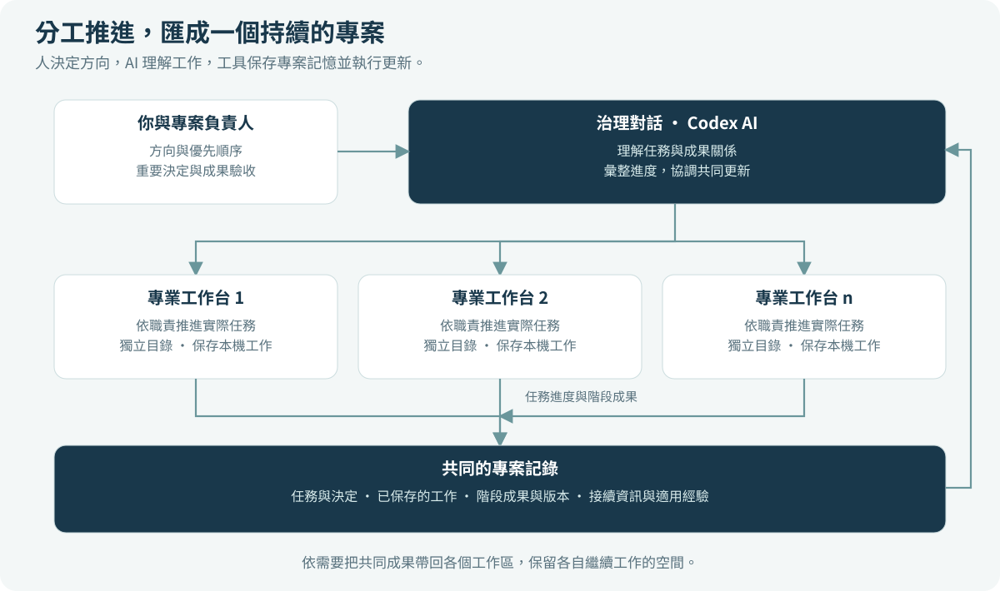
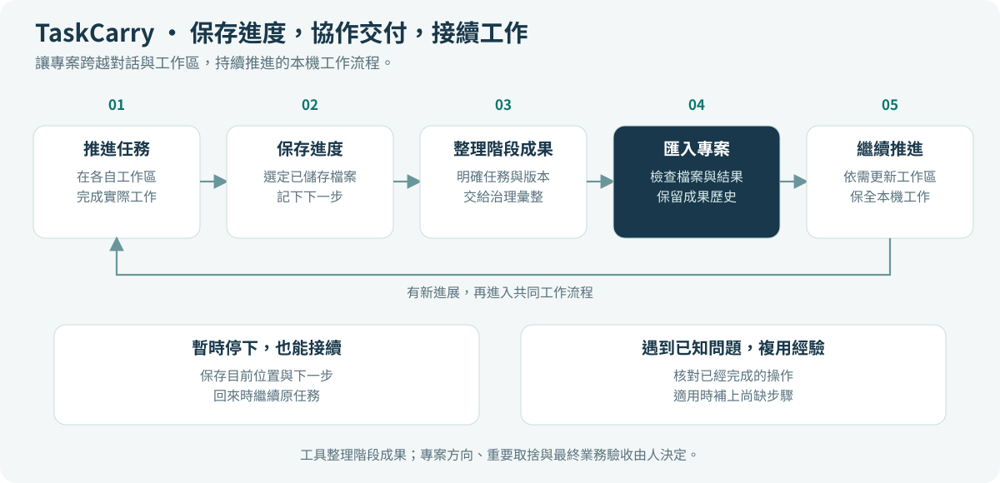
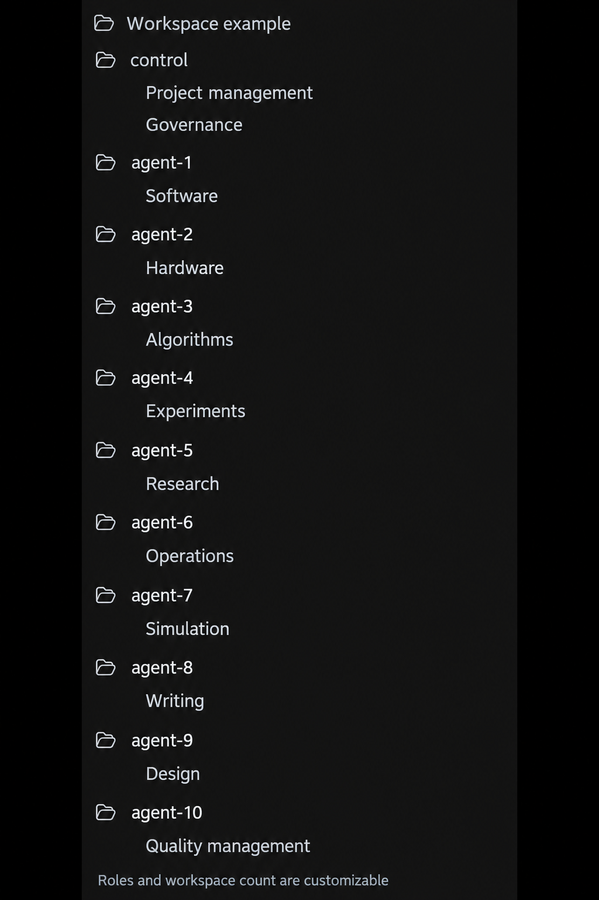

# Agent Co-Governance Toolkit

**讓 AI 協作擁有連續的專案記憶，讓多個工作台共同推進一個長期專案。**

[English](README.md) · [简体中文](README.zh-CN.md) · [繁體中文](README.zh-TW.md)

[下載與安裝](https://github.com/bryan123466/agent-co-governance-toolkit/releases) · [操作手冊](docs/zh-TW/windows-example.md) · [架構說明](docs/zh-TW/architecture.md)

[維護與升級既有專案](docs/zh-TW/governance-maintenance.md)

Agent Co-Governance Toolkit（AGCT）是一套面向 **Codex 使用者**的開源專案協作工具。它將分散在不同工作台的任務進度、階段成果、重要決定與接續資訊，整理成可保存、可追溯、可繼續使用的專案紀錄。

你可以讓不同的 Codex 對話分別推進軟體、硬體、演算法、科研、營運或文書工作，再由一個治理對話結合 AI 與工具，彙整進度、接收成果，並在合適的時候把共同成果更新到各個工作區。既有對話可以接入，正在進行的工作可以繼續。

**它適合已經在使用 Codex，希望把多個對話組織成長期專案的人。** 你負責專案方向與重要決定，Codex 負責理解和推進工作，AGCT 負責讓這些工作的狀態與成果有據可查。

## 為什麼需要 AGCT？

一段對話可以完成一個任務，但長期專案往往會跨越許多對話、檔案與版本。工作逐漸增多後，真正費力的事情變成了：

- 隔了一週回來，要重新解釋做到哪裡、為什麼這樣做、下一步是什麼。
- 幾個對話都在推進，卻很難看清哪些成果已經彙入專案，哪些還在各自的工作區。
- 同一任務迭代了多個版本，舊紀錄與目前待辦混在一起。
- 某次操作中斷後，不確定哪些已經完成，是否需要從頭再來。

AGCT 在日常工作中保存這些關係。**專案進度不必只靠對話上下文維持；各自獨立的工作，也可以彙整成一份清楚的整體狀態。**

## 你可以用它做什麼？

| 能力 | 對你的工作有什麼幫助 |
|---|---|
| **長期專案記憶** | 持久保存已登記任務的進度、關鍵決定、成果位置與下一步，方便跨會話接續。 |
| **多個工作台協作** | 為需要並行的任務準備獨立工作區，讓不同專業對話各自推進，再統一彙整。 |
| **按階段累積成果** | 一項任務不必全部結束才能貢獻成果。完成一個穩定階段，就可以交給治理整理並納入共同版本。 |
| **保留未完成工作** | 工作暫時停下時，保存選定檔案與接續說明。回來時能夠找到上次的位置，暫停的任務也可以安靜保留。 |
| **清楚管理迭代** | 記錄新舊成果之間的關係，保留歷史，並清楚區分已彙入專案的成果、準備接收的階段與暫時保留的工作。 |
| **複用已驗證的恢復方法** | 遇到工具已支援的已知問題時，先核對現況，再使用適用的恢復方法，減少重複操作。 |
| **每輪聚焦目前工作** | 從一致的專案快照讀取有限、可翻頁的待處理清單；暫停工作與已完成歷史持續保留，不自動增加交付義務。 |

這些能力由同一套本地工具提供。你可以透過 Codex 中接入的 MCP 工具使用，也可以用命令列操作；兩種方式讀寫同一份專案狀態。

## 人、AI 與工具如何協作？

**治理對話**是專案的協調入口。它使用 Codex 的理解能力閱讀已提供的工作資訊、判斷任務與成果的關係，再呼叫工具保存狀態、整理交付與更新工作區。

**專業對話**專注自己的實際工作。一個對話可以連續處理相關子任務；需要並行時，再增加獨立工作區。專業角色與數量由你的專案決定。

**AGCT 工具**把任務、檔案、版本與操作結果保存下來，並在執行更新前核對目標與條件。AI 負責理解，工具負責可重複的記錄與執行，人保留方向、重要取捨與最終業務決定。

這種分工讓協作有一份共同依據，也讓每個工作台可以保留自己的工作節奏。

## 從開始工作到繼續推進

例如，一個產品專案可以讓三個工作台分別負責軟體、實驗與文件。軟體完成了一個可用模組，實驗還在準備，文件已經形成初稿。治理可以先接收軟體的穩定成果，同時記錄實驗與文件目前的位置。它們不必等整個專案一起完成。

之後軟體又迭代出新版本，治理會依據已宣告的任務與版本關係整理成果，保留必要歷史。需要採用共同進度的工作區，會先核對並保全支援範圍內的本地工作；遇到衝突，則說明具體衝突，讓相關工作區先處理。

這裡的「接收」，指把階段成果整理進專案。是否達到產品目標、能否對外交付，仍由你與相應負責人判斷。

## 長期記憶保存的是什麼？

AGCT 將專案記憶放在對話之外，保存在你的本地專案中。它記錄的是**接續工作真正需要的資訊**：

| 專案紀錄 | 日後可以回答的問題 |
|---|---|
| 任務狀態與關鍵決定 | 這件事推進到哪裡？為什麼這樣安排？ |
| 已保存的工作與下一步 | 上次停在哪裡？接下來應該做什麼？ |
| 階段成果與版本關係 | 哪一份已經彙入專案？它從哪個階段演進而來？ |
| 檔案引用與成果位置 | 素材放在哪裡？是否需要另行保存？ |
| 操作結果與適用經驗 | 哪些已經執行？遇到同類問題可以參考什麼方法？ |

你不必把每份大型檔案都放進 Git。工具可以記錄素材位置，方便查找與安排備份；檔案的實際複製與備份，仍依你的儲存方式完成。需要遠端保存專案成果與選定紀錄時，可以按照手冊設定私有 Git 儲存庫。

這些資訊由你或治理對話明確記錄，未記錄的對話決定不會自動成為專案記憶。它來自你接入的任務與工作素材，不會自動收集全部對話，也不會替你保存編輯器中尚未寫入磁碟的內容。

## 接入既有專案，或從新專案開始

**既有工作可以延續。** 在原對話中整理目前任務、成果、重要背景與未完成工作，交給治理完成接入，再把接續說明帶回原對話。你可以繼續使用合適的原視窗，不必把專案重新做一遍。

**需要並行時再增加工作台。** 一個工作台對應清楚的任務範圍；多個工作台透過獨立目錄與 Git 工作樹分別推進。若幾個舊對話一直共用同一個目錄，先保留一個主要寫入者，其餘需要並行的職責，依手冊移入獨立工作區。

上圖是通用組織示意。專業名稱與數量由你決定，備用對話或觀察對話也不是必要設定。

## 三步開始

1. **準備一個專案。** [下載產品包](https://github.com/bryan123466/agent-co-governance-toolkit/releases)，依照[操作手冊](docs/zh-TW/windows-example.md#choose)建立專案目錄。一個目錄對應一個實際專案。
2. **建立治理對話。** 選擇手冊指定的目錄，貼上[安裝提示詞](docs/zh-TW/windows-example.md#install)，填寫 **【專案名稱】**與 **【一句話介紹】**。
3. **接入你的工作。** [繼續既有對話](docs/zh-TW/windows-example.md#existing)，或[新增專業工作台](docs/zh-TW/windows-example.md#agents)，填寫 **【每個工作台負責的實際內容】**，然後開始推進。

完整操作手冊提供目錄範例、可複製的提示詞、MCP 接入與自動化設定。依照步驟操作即可，不需要先閱讀核心原始碼或執行開發測試。

## 從本地協作逐步擴充

- **定時整理專案。** 在 Codex 等宿主中設定排程任務，讓治理對話依計畫檢查已接入的工作、彙整變化，並處理符合條件的更新。排程設定由宿主提供。
- **使用私有 Git 保存成果。** 將選定成果與專案紀錄推送到自己的遠端儲存庫，方便追溯與恢復。遠端同步需要另行設定，並依你的授權執行。
- **把不同任務分配到不同電腦。** 手冊提供獨立任務分支、單一整合電腦的建議流程。該流程尚未完成實際雙電腦端到端驗證，適合在本地流程穩定後評估採用。

## 技術與使用方式

AGCT 使用 **Python 3.11+ 與 Git**，由你現有的 **Codex** 提供 AI 能力。它包含本地執行核心、CLI、MCP 介面與四類專案技能：安裝接入、任務交付、治理接收、經驗恢復。工具執行時使用 Python 標準函式庫，不需要另建模型服務。

每個 control 治理範圍使用一份本地狀態，以及一條接收共同成果的基線。包含獨立倉庫的產品可以分別配置，再由一個治理聊天彙整進度；同一工作區的並行寫入與更新仍需協調。恢復功能涵蓋已實作並經過驗證的方法，不能保證自動解決所有未知故障。更多實作細節見[架構說明](docs/zh-TW/architecture.md)與[使用範圍](docs/RELEASE_BOUNDARIES.md)。

## 文件與參與

| 文件 | English | 简体中文 | 繁體中文 |
|---|---|---|---|
| 產品介紹 | [README](README.md) | [项目介绍](README.zh-CN.md) | [專案介紹](README.zh-TW.md) |
| 操作手冊 | [Manual](docs/en/windows-example.md) | [完整手册](docs/zh-CN/windows-example.md) | [完整手冊](docs/zh-TW/windows-example.md) |
| 快速瞭解 | [Overview](docs/en/getting-started.md) | [快速了解](docs/zh-CN/getting-started.md) | [快速瞭解](docs/zh-TW/getting-started.md) |
| 架構說明 | [Architecture](docs/en/architecture.md) | [架构](docs/zh-CN/architecture.md) | [架構](docs/zh-TW/architecture.md) |
| 私有 Git 與多電腦 | [Guide](docs/en/remote-and-multicomputer.md) | [说明](docs/zh-CN/remote-and-multicomputer.md) | [說明](docs/zh-TW/remote-and-multicomputer.md) |

[CLI / MCP 技術參考](docs/COMMANDS.md) · [公開技能](skills) · [貢獻指南](https://github.com/bryan123466/agent-co-governance-toolkit/blob/main/CONTRIBUTING.md) · [問題與建議](https://github.com/bryan123466/agent-co-governance-toolkit/issues)

歡迎分享使用情境、提出問題或貢獻改進。提交回饋前，請移除專案素材、個人路徑、憑證與敏感執行紀錄；具體說明見[安全指引](SECURITY.md)。版本變更記錄在 [Releases](https://github.com/bryan123466/agent-co-governance-toolkit/releases)。

## 開源授權

公開原始碼、文件、範本與範例採用 [MIT](LICENSE) 授權，可依授權條款使用、修改與商業複用。你使用工具管理的專案與資料仍由你控制；本儲存庫不包含任何私有業務專案。相依工具與服務適用各自的授權與使用條款，詳見[授權範圍](LICENSE_SCOPE.md)。
