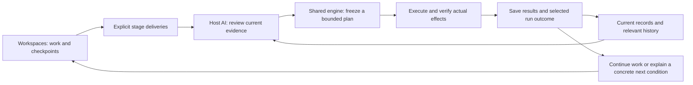

# A smaller, more reliable governance loop

[简体中文](../zh-CN/governance-evolution.md) · [繁體中文](../zh-TW/governance-evolution.md) · [Product home](../../README.md)

TaskCarry helps several AI-assisted workspaces continue one project without making chat history the only record of progress. Its design evolved toward a smaller loop: the host AI understands the evidence, one shared engine records and executes the supported work, and the next session continues from those records.

This report explains the reusable design lessons and their synthetic verification. It contains no deployment history or data from a private project. New users follow the normal [operating walkthrough](windows-example.md); historical migration and cleanup are not installation requirements.

## What we simplified

| Earlier pattern | Current approach | Practical effect |
|---|---|---|
| Revisit completed history to discover today's work | Read a derived index of current work; retrieve supporting history when needed | Unrelated completed history does not have to enter every agenda query |
| Treat every unchanged task as unfinished governance | Keep a task's checkpoint separately from its declared delivery | A paused task remains resumable without becoming another reminder or receiving obligation |
| Record status and its event in separate writes | Save related local facts and events in one database transaction | An interrupted write cannot leave a successful status without its associated local event |
| Rely on a chat remembering which evidence it reviewed | Persist the reviewed source revision, task/workspace binding and explicit relationships | A later run can distinguish unchanged evidence from a changed source |
| End with a broad success statement | Freeze a named run scope and check its recorded results | A finished batch is distinguishable from the project's remaining work |
| Repeat the full workflow after a lost reply | Check the journal and actual Git effect, then finish only supported missing steps | Recovery avoids treating a missing acknowledgment as proof that nothing happened |
| Merge every workspace whenever shared progress changes | Read common progress directly; adopt accepted code only for a task dependency | Ordinary reporting does not disturb local development |

These changes reduce repeated work and ambiguous handoffs. They do not eliminate the need to understand a task, resolve a real content conflict or obtain a business decision.

## The everyday loop



CLI, MCP and Skills support this same loop. They do not each create a separate decision database. The AI can use authorized host tools to review a connected conversation, but TaskCarry itself does not crawl every conversation or infer authorization from a stored reference.

## Memory that supports the next action

A useful project memory keeps three kinds of information together:

- **Current position:** the task, checkpoint, declared stage and unfinished operation that matter now.
- **Reasons and evidence:** source references, reviewed revisions and explicit task or material relationships.
- **History:** earlier stages, completed operations and failures retained for explanation and recovery.

An observation stores what the host reports having reviewed. Updating it checks the previous revision, so a stale writer cannot silently replace a newer observation. The reference is not proof that the source is true, permission to read it, or a substitute for a Git receipt. The AI remains responsible for interpreting evidence within its available access.

The current index is a rebuildable view over the records, not a second authoritative history. Fresh projects create it during initialization. Older stores remain readable through a full-selection fallback; the explicit `upgrade` action builds or repairs the index without discarding records or events. If an older writer invalidates the index, the fallback preserves visibility of new work until it is rebuilt.

## Recovery with clear limits

Local database transactions keep related records and events together. Git effects are a separate concern: an operation can change Git before a reply or final record is saved. TaskCarry preserves the operation journal, checks the actual effect and uses supported recovery behavior to finish the missing receipt. A database rollback must not erase the evidence of an already-applied Git operation.

Experience entries identify a concrete failure condition and a supported action. For example, `verify_and_finalize` can help finish a receipt after verifying an existing result; `refresh_plan` suggests replanning when its conditions hold. An experience note does not install a code fix, grant additional permissions or create a new executable recovery action.

Shared defects belong in the shared implementation: reproduce them in a disposable project, fix the behavior, retain the regression test, release a version and confirm the installation that will use it. Installation evidence and a live host connection check answer different questions. A newly installed package does not prove that an already-open MCP process has reloaded.

## What the structural tests establish

| Synthetic check | Result or property checked | What it does not establish |
|---|---|---|
| Keep current work fixed; grow completed stages, operations, old plans and checkpoints from 100 to 1,000 groups | `agenda` loads 5 necessary records in both cases, with the same selection and fingerprint | Constant cost as current work grows, or a guaranteed wall-clock speedup |
| Interrupt a related event write | Related local state rolls back; a retry records one successful change | A transaction spanning arbitrary files, remote services and Git |
| Rebuild a legacy or invalidated current index | Original records/events remain unchanged and the selected work agrees with the fallback | General migration between arbitrary storage formats |
| Review a source again and finish a selected run | Revision checks, explicit relationships and recorded terminal states determine the result | Independent validation of source meaning or whole-project completion |

The first comparison measures database work on generated records. It does not compare unlike production runs or claim a percentage reduction in human effort. Less irrelevant history and fewer repeated side effects are the supported structural benefits; actual elapsed time also depends on current work, Git operations, the host and model decisions.

Maintainers can reproduce the focused checks from a source checkout:

```sh
python -m unittest tests.test_incremental_view tests.test_atomic_store tests.test_continuity -v
```

The tests use disposable synthetic projects. See the source repository's [validation record](https://github.com/bryan123466/taskcarry/blob/main/docs/VALIDATION.md) for the tested version and remaining coverage. Installing the product does not require running this development suite.

## What stays optional

Local governance does not require a remote repository. GitHub publishing, broad source discovery, automatic package upgrades and physical multi-computer takeover are separate capabilities with their own requirements. They are not silently enabled by these changes.

The design continues to use the host language model and the shared engine. It does not train model weights or start an additional resident governance model. The useful improvement is a more precise path from evidence to action, with durable records that let the next run continue.
