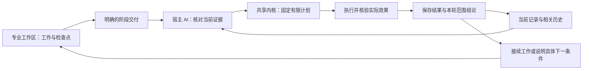

# 把治理收敛为一个更小、更可靠的闭环

[English](../en/governance-evolution.md) · [繁體中文](../zh-TW/governance-evolution.md) · [产品首页](../../README.zh-CN.md)

TaskCarry 帮助多个 AI 工作区持续推进同一个项目，让聊天历史不再成为唯一的进度记录。它的设计逐渐收敛为一个更小的闭环：宿主 AI 理解证据，共享内核保存并执行已支持的工作，下一轮从这些记录继续。

这份报告介绍可复用的设计经验及合成验证，不包含私有项目的部署历史或资料。新用户按正常的[操作手册](windows-example.md)接入即可，历史迁移与清理不是安装前提。

## 简化了什么

| 较早的处理模式 | 当前做法 | 实际作用 |
|---|---|---|
| 为了找当前工作，反复阅读已完成历史 | 读取当前事项的派生索引，按需取相关历史依据 | 无关的已完成历史不必进入每轮 agenda 查询 |
| 把状态未变的任务都列为待治理事项 | 分开保存任务检查点和明确交付 | 暂停任务仍可接续，但不会因此新增提醒或接收义务 |
| 分别写入状态与事件 | 在同一个数据库事务中保存相关事实和事件 | 写入中断时，不留下缺少对应本地事件的成功状态 |
| 依靠聊天记住已核对的证据 | 保存来源版本、任务与工作区绑定及明确关联 | 下一轮可以区分原证据未变与来源已更新 |
| 最后只给一个笼统的成功结论 | 固定本轮具名范围，核对对应结果 | 分清本批完成与整个项目仍需推进的工作 |
| 没收到回复就重跑完整流程 | 对照操作记录和实际 Git 效果，只补支持续办的缺步 | 不把缺少确认误判为操作从未发生 |
| 共享进度一更新就合并全部工作区 | 直接读取公共进度，仅在任务需要成果依赖时采用代码 | 日常汇报无需打断本地开发 |

这些变化减少重复操作和含糊交接。理解任务、解决真实内容冲突和作出业务决定，仍然需要相应判断。

## 日常闭环



CLI、MCP 和 Skills 使用同一条流程，不各自建立一套决策数据库。AI 可以通过已授权的宿主工具核对已接入的对话；TaskCarry 本身不会抓取全部聊天，也不会从一条来源引用推定读取或执行权限。

## 让记忆支持下一步动作

有用的项目记忆同时保存三类内容：

- **当前位置：** 当前任务、检查点、明确阶段和未完成操作。
- **依据与关联：** 来源引用、已核对版本，以及明确的任务或材料关系。
- **历史：** 用于解释与恢复的早期阶段、已完成操作和失败记录。

观察记录保存的是宿主报告已核对的内容。更新时检查前一个版本，避免旧写入者悄悄覆盖较新的观察。引用本身不证明来源真实，不授予读取权限，也不替代 Git 回执；AI 仍需在实际可访问范围内理解证据。

当前事项索引是可重建的记录视图，不是第二份权威历史。新项目初始化时直接创建索引。旧状态库仍可通过完整选取方式读取；显式 `upgrade` 动作建立或修复索引，保留原记录和事件。旧版写入者使索引失效时，回退读取仍能看到新工作，重建后再恢复索引查询。

## 恢复能力的明确范围

本地数据库事务保证相关记录与事件一起保存。Git 效果另行处理：Git 可能已经改变，但回复或最后的记录尚未保存。TaskCarry 保留操作记录，核对实际效果，再按已有恢复能力补齐回执。数据库回滚不能抹去已发生 Git 操作的依据。

经验记录对应具体故障条件和已支持的动作。例如，`verify_and_finalize` 可在核验已有结果后协助补齐回执；`refresh_plan` 在适用条件下建议重新规划。一条经验说明不会安装代码修正、扩大权限或产生新的可执行恢复动作。

公共缺陷应修在共享实现中：在独立项目复现，修正行为，保留回归测试，发布版本，再确认将要使用它的环境确实安装。安装证明与实际宿主连接检查解决的是不同问题；新包安装成功，不代表已经打开的 MCP 进程已重新加载。

## 结构性验证说明了什么

| 合成检查 | 核对到的结果或性质 | 不能据此推断 |
|---|---|---|
| 当前工作固定，已完成阶段、操作、旧计划和检查点从 100 组增加到 1,000 组 | 两种情况下 agenda 都只加载 5 条必要记录，选取结果和指纹一致 | 当前工作无限增加时仍为固定成本，或确定的耗时降幅 |
| 在相关事件写入时注入中断 | 相关本地状态回滚，重试只记录一次成功变化 | 任意文件、远端服务与 Git 之间的统一事务 |
| 重建旧状态库或失效索引 | 原记录与事件不变，选取结果与回退方式一致 | 任意存储格式之间的通用迁移 |
| 再次核对来源并结束具名一轮 | 依据版本检查、明确关联和已记录终态判断结果 | 对来源含义的独立验证或整个项目已完成 |

第一项比较使用生成记录测量数据库工作，不比较条件不同的生产轮次，也不宣称人工投入减少了某个百分比。已有依据支持的收益是减少无关历史读取和重复副作用；实际时间仍取决于当前任务量、Git 操作、宿主和模型判断。

维护者可在源码目录复现这些定向检查：

```sh
python -m unittest tests.test_incremental_view tests.test_atomic_store tests.test_continuity -v
```

测试使用可丢弃的合成项目。具体受测版本和未覆盖范围见源码仓库的[验证记录](https://github.com/bryan123466/taskcarry/blob/main/docs/VALIDATION.md)。安装产品无需运行这套开发测试。

## 哪些仍按需提供

本地治理不要求远端仓库。GitHub 发布、广泛来源发现、自动包升级和实体多电脑接管各有自己的条件，不会随本次改动悄悄启用。

这套设计继续使用宿主语言模型与共享内核，不训练模型权重，也不增加常驻治理模型。实际增强的是从证据到动作的清晰路径，以及让下一轮可靠接续的持久记录。
