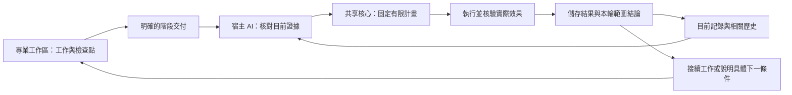

# 把治理收斂為一個更小、更可靠的閉環

[English](../en/governance-evolution.md) · [简体中文](../zh-CN/governance-evolution.md) · [產品首頁](../../README.zh-TW.md)

TaskCarry 協助多個 AI 工作區持續推進同一個專案，讓對話歷史不再成為唯一的進度記錄。它的設計逐漸收斂為一個更小的閉環：宿主 AI 理解證據，共享核心儲存並執行已支援的工作，下一輪從這些記錄繼續。

這份報告介紹可重用的設計經驗及合成驗證，不包含私有專案的部署歷史或資料。新使用者按正常的[操作手冊](windows-example.md)接入即可，歷史遷移與清理不是安裝前提。

## 簡化了什麼

| 較早的處理模式 | 目前做法 | 實際作用 |
|---|---|---|
| 為了找目前工作，反覆閱讀已完成歷史 | 讀取目前事項的衍生索引，按需取相關歷史依據 | 無關的已完成歷史不必進入每輪 agenda 查詢 |
| 把狀態未變的任務都列為待治理事項 | 分開儲存任務檢查點和明確交付 | 暫停任務仍可接續，但不會因此新增提醒或接收義務 |
| 分別寫入狀態與事件 | 在同一個資料庫交易中儲存相關事實和事件 | 寫入中斷時，不留下缺少對應本機事件的成功狀態 |
| 依靠對話記住已核對的證據 | 儲存來源版本、任務與工作區綁定及明確關聯 | 下一輪可以區分原證據未變與來源已更新 |
| 最後只給一個籠統的成功結論 | 固定本輪具名範圍，核對對應結果 | 分清本批完成與整個專案仍需推進的工作 |
| 沒收到回覆就重跑完整流程 | 對照操作記錄和實際 Git 效果，只補支援接續的缺步 | 不把缺少確認誤判為操作從未發生 |
| 共享進度一更新就合併全部工作區 | 直接讀取公共進度，僅在任務需要成果依賴時採用程式碼 | 日常彙報無需打斷本機開發 |

這些變化減少重複操作和含糊交接。理解任務、解決真實內容衝突和作出業務決定，仍然需要相應判斷。

## 日常閉環



CLI、MCP 和 Skills 使用同一條流程，不各自建立一套決策資料庫。AI 可以透過已授權的宿主工具核對已接入的對話；TaskCarry 本身不會抓取全部對話，也不會從一條來源引用推定讀取或執行權限。

## 讓記憶支援下一步動作

有用的專案記憶同時儲存三類內容：

- **目前位置：** 目前任務、檢查點、明確階段和未完成操作。
- **依據與關聯：** 來源引用、已核對版本，以及明確的任務或材料關係。
- **歷史：** 用於解釋與恢復的早期階段、已完成操作和失敗記錄。

觀察記錄儲存的是宿主報告已核對的內容。更新時檢查前一個版本，避免舊寫入者悄悄覆蓋較新的觀察。引用本身不證明來源真實，不授予讀取權限，也不替代 Git 回執；AI 仍需在實際可存取範圍內理解證據。

目前事項索引是可重建的記錄視圖，不是第二份權威歷史。新專案初始化時直接建立索引。舊狀態庫仍可透過完整選取方式讀取；明確的 `upgrade` 動作建立或修復索引，保留原記錄和事件。舊版寫入者使索引失效時，回退讀取仍能看到新工作，重建後再恢復索引查詢。

## 恢復能力的明確範圍

本機資料庫交易保證相關記錄與事件一起儲存。Git 效果另行處理：Git 可能已經改變，但回覆或最後的記錄尚未儲存。TaskCarry 保留操作記錄，核對實際效果，再按既有恢復能力補齊回執。資料庫回復不能抹去已發生 Git 操作的依據。

經驗記錄對應具體故障條件和已支援的動作。例如，`verify_and_finalize` 可在核驗既有結果後協助補齊回執；`refresh_plan` 在適用條件下建議重新規劃。一條經驗說明不會安裝程式碼修正、擴大權限或產生新的可執行恢復動作。

公共缺陷應修在共享實作中：在獨立專案重現，修正行為，保留回歸測試，發布版本，再確認將要使用它的環境確實安裝。安裝證明與實際宿主連線檢查解決的是不同問題；新套件安裝成功，不代表已經開啟的 MCP 程序已重新載入。

## 結構性驗證說明了什麼

| 合成檢查 | 核對到的結果或性質 | 不能據此推斷 |
|---|---|---|
| 目前工作固定，已完成階段、操作、舊計畫和檢查點從 100 組增加到 1,000 組 | 兩種情況下 agenda 都只載入 5 條必要記錄，選取結果和指紋一致 | 目前工作無限增加時仍為固定成本，或確定的耗時降幅 |
| 在相關事件寫入時注入中斷 | 相關本機狀態回復，重試只記錄一次成功變化 | 任意檔案、遠端服務與 Git 之間的統一交易 |
| 重建舊狀態庫或失效索引 | 原記錄與事件不變，選取結果與回退方式一致 | 任意儲存格式之間的通用遷移 |
| 再次核對來源並結束具名一輪 | 依據版本檢查、明確關聯和已記錄終態判斷結果 | 對來源含義的獨立驗證或整個專案已完成 |

第一項比較使用生成記錄測量資料庫工作，不比較條件不同的生產輪次，也不宣稱人工投入減少了某個百分比。既有依據支援的收益是減少無關歷史讀取和重複副作用；實際時間仍取決於目前任務量、Git 操作、宿主和模型判斷。

維護者可在原始碼目錄重現這些定向檢查：

```sh
python -m unittest tests.test_incremental_view tests.test_atomic_store tests.test_continuity -v
```

測試使用可丟棄的合成專案。具體受測版本和未涵蓋範圍見原始碼儲存庫的[驗證記錄](https://github.com/bryan123466/taskcarry/blob/main/docs/VALIDATION.md)。安裝產品無需執行這套開發測試。

## 哪些仍按需提供

本機治理不要求遠端儲存庫。GitHub 發布、廣泛來源探索、自動套件升級和實體多電腦接管各有自己的條件，不會隨本次改動悄悄啟用。

這套設計繼續使用宿主語言模型與共享核心，不訓練模型權重，也不增加常駐治理模型。實際增強的是從證據到動作的清晰路徑，以及讓下一輪可靠接續的持久記錄。
